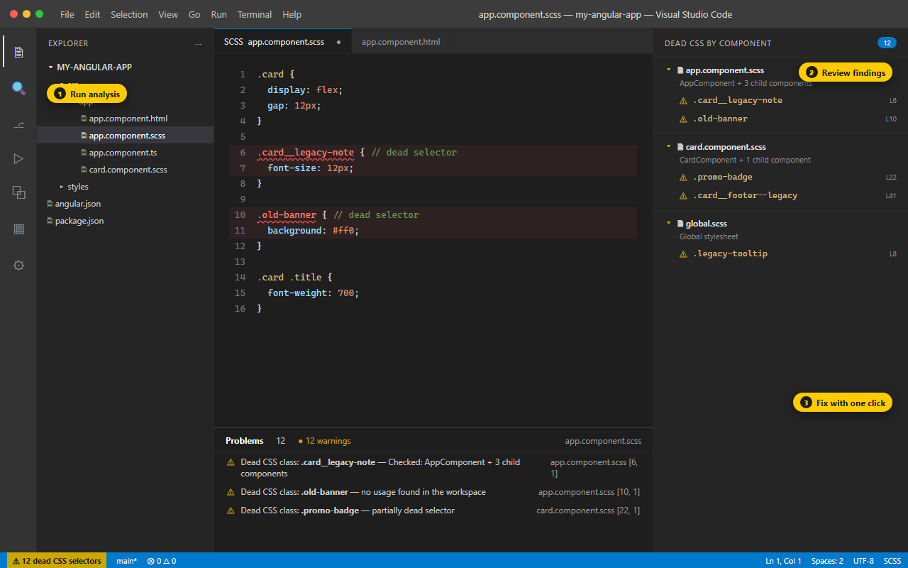

# Dead CSS Cleaner

**Find and remove unused CSS selectors in React, Angular, Vue, Svelte, Astro and plain HTML/CSS projects** - including nested child selectors, framework class bindings and single-page `index.html` + `styles.css` setups with no framework at all.

<p align="center">
  
  
  
  
  
  
  
  
  
  
  
  
  
  
  
  
  
  
  
  
  
  
  
</p>

<div align="center">
  <h3>
    <a href="https://marketplace.visualstudio.com/items?itemName=RajatMalik.dead-css-cleaner">View on Marketplace</a>
    •
    <a href="https://github.com/malikrajat/dead-css-cleaner">Source Code</a>
    •
    <a href="./doc/USER-GUIDE.md">Visual Guide</a>
    •
    <a href="./doc/README.md">Documentation</a>
  </h3>
</div>

<div align="center">
  <p>
    <strong>Framework-Aware</strong> ·
    <strong>Component-Scoped</strong> ·
    <strong>One-Click Fixes</strong> ·
    <strong>Zero Telemetry</strong> ·
    <strong>Works Offline</strong>
  </p>
</div>

## See It In Action

<div align="center">

  

</div>

## Table of Contents

- [Quick Start](#quick-start)
- [Features](#features)
- [Quick Start Guide](#quick-start-guide)
- [Dead CSS per Component](#dead-css-per-component)
- [What Gets Scanned](#what-gets-scanned)
- [How Detection Works](#how-detection-works)
- [Commands](#commands)
- [Settings](#settings)
- [Avoiding False Positives](#avoiding-false-positives)
- [Use It Without VS Code (CLI)](#use-it-without-vs-code-cli)
- [Code Examples](#code-examples)
- [Documentation](#documentation)
- [Performance Optimization](#performance-optimization)
- [Testing Examples](#testing-examples)
- [Migration Guide](#migration-guide)
- [FAQ](#faq)
- [Troubleshooting](#troubleshooting)
- [Reporting a Problem](#reporting-a-problem)
- [Architecture](#architecture)
- [Contributing](#contributing)
- [Changelog](./CHANGELOG.md)
- [License](#license)

## Live Demo & Playground

| | |
| --- | --- |
| <a href="https://marketplace.visualstudio.com/items?itemName=RajatMalik.dead-css-cleaner" target="_blank"></a><br/><br/><sub><b>One-Click Install</b></sub><br/><sub>Search "Dead CSS Cleaner" in VS Code</sub> | <a href="./doc/USER-GUIDE.md" target="_blank"></a><br/><br/><sub><b>Four-Step Walkthrough</b></sub><br/><sub>Install, analyse, review, fix</sub> |
| <a href="./doc/README.md" target="_blank"></a><br/><br/><sub><b>Documentation Index</b></sub><br/><sub>Configuration, architecture and troubleshooting</sub> | <a href="https://github.com/malikrajat/dead-css-cleaner/issues/new?template=bug_report.yml" target="_blank"></a><br/><br/><sub><b>Bug Reports</b></sub><br/><sub>False positives are treated as bugs</sub> |
| <a href="https://github.com/malikrajat/dead-css-cleaner" target="_blank"></a><br/><br/><sub><b>Source Code</b></sub><br/><sub>Star, fork, and contribute</sub> | <a href="https://github.com/sponsors/malikrajat" target="_blank"></a><br/><br/><sub><b>Support the Project</b></sub><br/><sub>Keep the extension maintained</sub> |

## Quick Start

Dead CSS Cleaner analyses your stylesheets, works out which class and id selectors are never referenced anywhere in your components or templates, and reports them in the Problems panel with a one-click fix. Less dead CSS means a smaller stylesheet, a smaller bundle and less code to maintain.

It is built for real component codebases: nested child selectors are checked token by token, framework bindings such as `[ngClass]="{ open: isOpen }"` and `clsx(...)` are understood, and a class declared in a parent stylesheet but applied by a child component is never called dead. A standalone CLI runs the exact same pipeline in CI or on a minimal reproduction.

### Installation

```bash
# From the Marketplace: search for "Dead CSS Cleaner" in the Extensions view
# Or install a packaged VSIX:
code --install-extension dead-css-cleaner-2.2.0.vsix
```

### Basic Usage

1. Open a project that contains stylesheets.
2. Press `Ctrl/Cmd + Alt + D`, click **Dead CSS Cleaner** in the status bar, or run *Dead CSS Cleaner: Analyze Workspace for Dead CSS* from the Command Palette.
3. Open the **Problems** panel (`Ctrl/Cmd + Shift + M`) to review the exact class or id that was flagged.
4. Put the cursor on a finding, press `Ctrl/Cmd + .` and choose a fix: remove the token, remove the whole rule, add an ignore comment, or clean the entire file.

Analysis also runs automatically after you save a file, when you switch files, and when the file watcher sees a new or removed file.

```text
$(sync~spin) Analysing CSS...      ->      $(warning) 12 dead CSS selectors
```

---

## Features

- **Framework-aware usage detection**: Reads React/Preact JSX, Angular templates and decorators, Vue, Svelte, Astro, plain HTML, and server templates such as ERB, Twig, Handlebars, EJS, Razor and MDX
- **Component-scoped validation**: Matches every stylesheet to the component that declares it, then checks the owning component **and its child components** before calling a token dead
- **Per-component reporting**: Shows the actual dead classes grouped by owner, with the full nested selector chain and the scope that was searched
- **Nested and nth-level selectors**: Checks every token in a chain independently (`.card .body .title span`) instead of guessing from the whole selector
- **Partially dead detection**: Separates a fully dead selector from one whose used and unused tokens are mixed, and tells you which tokens are still in use
- **Framework bindings**: Understands `className`, CSS modules, `clsx`/`cx`/`classnames`, ternaries, `&&`, arrays, objects and template literals, plus Angular `[class.x]`, `[ngClass]`, `host` and `@HostBinding`
- **Dynamic class awareness**: Recognises `` `item-${size}` ``, `'btn-' + size`, `[class*="col-"]` and `class="chip chip--{{ size }}"` as patterns, so runtime-built names are never reported as dead
- **Real SCSS and Less parsing**: Uses `postcss-scss` and `postcss-less`, so `&__title`, `#{$size}` and `@{}` resolve correctly
- **Sidebar view**: "Dead CSS by component" groups findings by component, with reveal, remove and ignore actions on every row
- **Problems panel diagnostics**: One diagnostic per dead token, stating the validated scope, with related information pointing at where the used tokens appear
- **One-click fixes**: Remove a token, remove the whole rule, add an ignore comment, or clean every dead selector in a file after a confirmation prompt
- **Markdown and JSON reports**: Export a per-component report with selector chains, a "used elsewhere" section and the component graph
- **Status bar feedback**: A live count of dead selectors, with one-click access to the analysis
- **Standalone CLI**: The same pipeline from the terminal, with `--strict`, `--elements`, `--json` and `--report` modes
- **Built for large projects**: Per-file parse cache, batched processing, debounce, file-watcher throttling, size limits and cancellation of superseded analyses
- **Private by design**: No telemetry, no uploads and no backend; the diagnostics bundle is written locally and leaves your machine only when you send it
- **Deterministic unit tests**: 132 dependency-free tests run in plain Node, with integration tests in a real VS Code instance
- **Strict TypeScript**: `strict` mode, explicit error types, and a parse pipeline that never imports `vscode` in the core, parsers or analysis layers

---

## Quick Start Guide

### 1. Installation

**From the Marketplace**

1. Open VS Code and press `Ctrl/Cmd + Shift + X`.
2. Search for **Dead CSS Cleaner**.
3. Click **Install**, then reload if prompted.

**From a VSIX**

```bash
code --install-extension dead-css-cleaner-<version>.vsix
```

**Requirements**

- VS Code **1.90.0** or newer
- Node.js 18+ only if you build the extension yourself

The extension activates automatically when the workspace contains a CSS, SCSS, Sass or Less file.

### 2. Basic Integration

#### Option A: Analyze the workspace (Recommended)

Run **Dead CSS Cleaner: Analyze Workspace for Dead CSS** from the Command Palette, the status bar, the editor context menu, or with `Ctrl/Cmd + Alt + D`. Every stylesheet in the workspace is parsed and compared against every supported component, template and script.

#### Option B: Work from the component view

Open the **Dead CSS by component** view in the activity bar. It groups findings by the component that owns the stylesheet and offers reveal, remove and ignore actions on each row. Use **Refresh Dead CSS View** after a manual change, or let the file watcher keep it current.

| Surface | Use it for | Writes files? |
| --- | --- | --- |
| **Analyze Workspace** | First run, full-project audits, CI reproduction | No |
| **Analyze Current File Only** | Fast feedback while editing one stylesheet | No |
| **Dead CSS by component** | Deciding what to delete, per owner | Only through row actions |
| **Show Dead CSS Report** | Sharing a per-component report with a teammate | No |
| **Remove All Dead Selectors in This File** | Bulk cleanup after reviewing one file | Yes, with confirmation |
| **Export Dead CSS Report** | Tickets, reviews and historical snapshots | Yes, writes the report file |

### 3. Common Use Cases

#### Cleaning a React App That Builds Class Names

```jsx
<div className={clsx('card', isOpen && 'card--open', size === 'lg' ? 'card--lg' : '')} />
<div className={`item item--${size}`} />
```

`card`, `card--open` and `card--lg` are read as static usages. `item--*` is detected as a dynamic pattern, so a class such as `item--large` is never reported as dead. If your own convention builds names differently, add the prefix to `unusedCssDetector.dynamicClassPatterns`.

#### Validating a Parent Stylesheet Against Child Components

```text
CardComponent.scss -> CardComponent
CardComponent renders <app-card-body>, <CardBody />
Checked scope: CardComponent + CardBodyComponent + their templates
```

A class declared in `CardComponent.scss` but rendered by `CardBodyComponent` is used, not dead. This is the case that produces the most false positives in other tools.

#### Cleaning a Plain SPA With No Framework

```html
<div id="app" class="app-shell">
  <header class="site-header"><nav class="nav"><ul class="nav-list">...</ul></nav></header>
</div>
<style>.inline-used { color: rebeccapurple; }</style>
```

```css
.app-shell .site-header .nav .nav-list .nav-item .nav-link { color: var(--brand); }
```

HTML files and inline `<style>` blocks are scanned by default, so an `index.html` + `styles.css` project works with no configuration.

#### Running the Same Check in CI

```bash
npm run analyze -- path/to/project --strict --json
```

The CLI uses the production pipeline, so a false positive can be reproduced outside the editor and attached to a bug report.

### 4. Advanced Configuration

Settings can be changed per workspace or per folder. A typical tuned setup:

```json
{
  "unusedCssDetector.analysisMode": "token",
  "unusedCssDetector.componentScope": "tree",
  "unusedCssDetector.autoAnalyze": true,
  "unusedCssDetector.analyzeIds": true,
  "unusedCssDetector.analyzeElements": false,
  "unusedCssDetector.severity": "warning",

  "unusedCssDetector.includeFileTypes": [".css", ".scss", ".less", ".sass"],
  "unusedCssDetector.componentFileTypes": [".js", ".jsx", ".ts", ".tsx", ".mjs", ".cjs", ".mts", ".cts", ".vue", ".svelte", ".astro"],
  "unusedCssDetector.markupFileTypes": [".html", ".htm", ".vue", ".svelte", ".astro", ".php", ".erb", ".hbs", ".handlebars", ".twig", ".ejs", ".cshtml", ".razor", ".mdx", ".aspx", ".jsp"],

  "unusedCssDetector.excludePatterns": ["**/node_modules/**", "**/dist/**", "**/build/**", "**/vendor/**", "**/*.min.css"],
  "unusedCssDetector.dynamicClassPatterns": ["col-"],
  "unusedCssDetector.safelist": ["^js-"],
  "unusedCssDetector.ignoreSelectors": ["^legacy-"],

  "unusedCssDetector.enableCaching": true,
  "unusedCssDetector.cacheTimeout": 300000,
  "unusedCssDetector.maxConcurrentFiles": 12,
  "unusedCssDetector.debugLogging": false
}
```

Settings are validated by the extension at runtime; unknown or malformed values fall back to their defaults. `debugLogging` writes the parse decisions, dynamic prefixes, cache hits and unresolved bindings to the **Dead CSS Cleaner** output channel.

### 5. Programmatic Control

Commands and keybindings are the public control surface. Every command is also available from the Command Palette.

```text
unusedCssDetector.analyze                 Analyze Workspace for Dead CSS
unusedCssDetector.analyzeCurrentFile      Analyze Current File Only
unusedCssDetector.removeUnusedInFile      Remove All Dead Selectors in This File
unusedCssDetector.showComponentReport     Show Dead CSS Report (grouped by component)
unusedCssDetector.copyDeadCssList         Copy Dead CSS List
unusedCssDetector.exportReport            Export Dead CSS Report
unusedCssDetector.refreshDeadCssView      Refresh Dead CSS View
```

Analysis is idempotent: running it again replaces the previous findings instead of stacking a second set. A newer analysis cancels an older one, so a full workspace run started while a file-only run is in flight cannot leave mixed results behind.

### 6. Problems, Sidebar & Reports

By default each dead token becomes one diagnostic. The diagnostic tells you the exact token, the full selector, whether the selector is fully or partially dead, and which component tree was checked.

```text
card.component.scss:26  .card__legacy-note
  Dead CSS: class .card__legacy-note is not used in CardComponent or its child components
  Selector: .card .card__body .card__legacy-note (partially dead)
  Checked 5 file(s) in this component's tree
```

The **Dead CSS by component** view groups the same findings by owner:

```text
CardComponent
  2 dead · 1 used elsewhere
  .card__legacy-note     card.component.scss:26 · partially dead
  .card__old-badge       card.component.scss:40 · fully dead
  .card__shared-badge    card.component.scss:31 · used elsewhere
```

Need a portable artifact? Run **Export Dead CSS Report** to write `.dead-css-report.md` or `.dead-css-report.json` into the workspace. The Markdown report contains a summary, a per-component table (`line | selector chain | dead token | fully/partially dead`), a "used elsewhere" section and the component graph.

---

## Dead CSS per Component

A count is not enough when you have to decide what to delete. Dead CSS Cleaner reports the **actual classes**, grouped by the component that owns the stylesheet, and validates each one against that component **and its child components** first.

### Where to see it

| Surface | What it gives you |
| --- | --- |
| **Sidebar** - "Dead CSS by component" (activity bar) | Component → dead class, with the nested selector chain, the checked scope and where a token is used elsewhere. Row actions: reveal, remove, ignore. |
| **Report** - *Show Dead CSS Report (grouped by component)* | Markdown report with a summary, a per-component table (`line \| selector chain \| dead token \| fully/partially dead`), a "used elsewhere" section and the component graph. |
| **Copy list** - *Copy Dead CSS List* | Flat text for tickets or commits: `src/app/card.component.scss:26  .card__legacy-note  (selector: .card .card__body .card__legacy-note)`. |
| **Problems panel** | One diagnostic per dead token, stating the validated scope, with a lightbulb to remove the token, remove the rule or ignore it. |

### Parent styles validated against child components

This matters most in component frameworks: a class declared in a parent stylesheet is often rendered by a **child** component. Dead CSS Cleaner builds a component graph first:

```text
stylesheets  --> owners        CardComponent.scss -> CardComponent
components   --> children      CardComponent renders <app-card-body>, <CardBody />
scope        --> files         CardComponent + CardBodyComponent + their templates
```

Children are resolved from Angular component selectors (`<app-card-body>`), React/Vue/Svelte JSX or template usage, and relative imports - so it works however you name things (`CardBody`, `card-body`, `app-card-body`, `card-body.component.ts`).

Then each class is judged with three possible outcomes:

| Outcome | Meaning | Where it shows up |
| --- | --- | --- |
| **Dead** | Nothing in the owning component's tree uses it | Problems panel + report |
| **Used elsewhere** | Used in the workspace, but only outside the owning component's tree - not dead, but probably should move | Report + sidebar (never a diagnostic) |
| **Used** | Used inside the owning component, its children, or their templates | Not reported |

```text
CardComponent
  2 dead · 1 used elsewhere
  .card__legacy-note     card.component.scss:26 · partially dead
     Selector chain: .card .card__body .card__legacy-note
     Checked 5 file(s) in this component's tree
  .card__shared-badge    card.component.scss:31 · used elsewhere
     Used in ChildBadgeComponent.tsx
```

Control how far the check follows children with [`unusedCssDetector.componentScope`](#settings): `tree` (default), `component` (direct children only) or `off` (any usage anywhere counts, the pre-1.4 behaviour). Stylesheets that no component claims - a global `styles.css`, a plain SPA's `index.html` styles - stay whole-workspace, exactly as before.

---

## What Gets Scanned

| Group | Default extensions |
| --- | --- |
| Stylesheets | `.css`, `.scss`, `.less`, `.sass` plus `<style>` blocks inside any template file |
| Components / scripts | `.js`, `.jsx`, `.ts`, `.tsx`, `.mjs`, `.cjs`, `.mts`, `.cts`, `.vue`, `.svelte`, `.astro` |
| Markup / templates | `.html`, `.htm`, `.vue`, `.svelte`, `.astro`, `.php`, `.erb`, `.hbs`, `.handlebars`, `.twig`, `.ejs`, `.cshtml`, `.razor`, `.mdx`, `.aspx`, `.jsp` |

All three lists are configurable. `excludePatterns` skips `node_modules`, `dist`, `build`, `out`, `.next`, `.nuxt`, `.angular`, `.svelte-kit`, `vendor`, `*.min.css` and `*.d.ts` by default.

### Class and id usage that is recognised

**React / Preact / JSX / TSX**

```jsx
<div className="btn primary" />
<div className={styles.card__body} />
<div className={clsx('card', isOpen && 'card--open', size === 'lg' ? 'card--lg' : '')} />
<div className={`item item--${size}`} />
<div className={['flex', { 'is-active': active }]} />
React.createElement('div', { className: 'box box--wide' })

element.classList.add('is-visible');
document.querySelector('.wrapper .panel');   // both tokens count
element.setAttribute('class', 'legacy');
document.getElementById('main-app');
```

**Angular**

```ts
@Component({
  selector: 'app-card',
  template: `<div class="card"><p class="card__text">{{ t }}</p></div>`,  // backticks supported
  templateUrl: './card.component.html',
  styleUrls: ['./card.component.scss'],
  host: { '[class.host-open]': 'isOpen', class: 'host-base' }
})
export class CardComponent {
  @HostBinding('class.is-collapsed') collapsed = false;
}
```

```html
<div class="card card--wide" id="hero">
  <div [class.active]="isActive" [ngClass]="{ open: isOpen, 'is-large': isLarge }"></div>
  <span [ngClass]="['chip', isNew && 'chip--new']"></span>
  <i [ngClass]="isHot ? 'hot' : 'cold'"></i>
  <b ngClass="static-one static-two"></b>
  <em class="prefix {{ dynamic }} suffix"></em>
</div>
```

**Vue / Svelte / Astro**

```html
<!-- Vue -->
<div :class="{ active: isActive, disabled: isDisabled }"></div>
<div :class="['tag', isNew && 'tag--new']"></div>

<!-- Svelte -->
<div class="base" class:active={isActive} class:list={["a", "b"]}></div>

<!-- Astro -->
<div class:list={["card", condensed && "card--condensed"]}></div>
```

**Plain SPA (no framework)**

```html
<div id="app" class="app-shell">
  <header class="site-header"><nav class="nav"><ul class="nav-list">
    <li class="nav-item nav-item--active"><a class="nav-link">Home</a></li>
  </ul></nav></header>
</div>
<style>.inline-used { color: rebeccapurple; }</style>
```

```css
/* five levels deep - every token is checked */
.app-shell .site-header .nav .nav-list .nav-item .nav-link { color: var(--brand); }
```

---

## How Detection Works

Dead CSS Cleaner parses your stylesheets into class/id tokens with exact source positions, collects every class/id usage from your code, and compares the two. Findings become Problems panel diagnostics and status bar counts.

### Two reporting modes

`unusedCssDetector.analysisMode` controls how loud the extension is.

- **`token` (default)** - reports each unused class/id. If a selector is only *partially* dead (`.card .title` where `.card` is used but `.title` is not), the diagnostic says so and tells you which tokens are still used.
- **`strict`** - reports a selector only when **all** of its classes/ids are unused. Nothing partial is reported, which is ideal for deeply nested component styles.

### What is deliberately ignored

- `@keyframes`, `@font-face`, `@page`, `@property` and `@counter-style` blocks.
- Rules with no class or id tokens, such as `:root { --x: 1 }` or `* { box-sizing: border-box }`.
- Element-only selectors unless `analyzeElements` is enabled.
- Anything matching `ignoreSelectors`, `safelist`, a dynamic pattern, or an ignore comment.
- Unrelated string literals: `const greeting = 'Hello World'` does **not** mark `.Hello` or `.World` as used.

---

## Commands

| Command | Description | Default binding |
| --- | --- | --- |
| **Analyze Workspace for Dead CSS** | Full workspace analysis | `Ctrl/Cmd + Alt + D` |
| **Analyze Current File Only** | Fast check of the open stylesheet | - |
| **Show Dead CSS Report (grouped by component)** | Per-component report with nested selector chains | - |
| **Copy Dead CSS List** | Flat list for tickets and commits | - |
| **Refresh Dead CSS View** | Re-runs the analysis for the sidebar | - |
| **Remove All Dead Selectors in This File** | Bulk cleanup with a confirmation prompt | - |
| **Export Dead CSS Report** | Writes `.dead-css-report.md` or `.dead-css-report.json` | - |
| **Show Performance Statistics** | Timing per phase, cache hits and misses | - |
| **Clear Analysis Cache** | Forces a full re-parse | - |
| **Show Analysis Diagnostics Log** | Recovered parse problems and warnings | - |
| **Clear Diagnostics Log** | Empties the diagnostics log | - |
| **Show Output Log** | Opens the output channel (`debugLogging`) | - |
| **Export Logs** | Writes the complete log to one file and opens it in Notepad | - |
| **Download Diagnostics Bundle** | Writes a ZIP with logs, errors, settings and environment | - |
| **Open Settings** | Filters Settings to this extension | - |

---

## Settings

### Analysis

| Setting | Default | Description |
| --- | --- | --- |
| `unusedCssDetector.analysisMode` | `token` | `token` or `strict` reporting |
| `unusedCssDetector.componentScope` | `tree` | Follow child components when checking usage: `tree`, `component` or `off` |
| `unusedCssDetector.autoAnalyze` | `true` | Analyse on save, open and change |
| `unusedCssDetector.analyzeIds` | `true` | Report unused `#id` selectors |
| `unusedCssDetector.analyzeElements` | `false` | Report unused element selectors like `article {}` |
| `unusedCssDetector.severity` | `warning` | Problems panel severity |
| `unusedCssDetector.tagUnnecessary` | `false` | Dim findings instead of warning |
| `unusedCssDetector.maxUsageLocations` | `5` | Usage locations kept per token |

### Files

| Setting | Default | Description |
| --- | --- | --- |
| `unusedCssDetector.includeFileTypes` | `.css .scss .less .sass` | Stylesheet extensions |
| `unusedCssDetector.componentFileTypes` | `.js .jsx .ts .tsx .mjs .cjs .mts .cts .vue .svelte .astro` | Component and script extensions |
| `unusedCssDetector.markupFileTypes` | `.html .htm .vue .svelte .astro ...` | Template extensions |
| `unusedCssDetector.excludePatterns` | node_modules, dist, build, out, ... | Skipped glob patterns |
| `unusedCssDetector.minFilesForAnalysis` | `1` | Minimum style files before analysing |

### False-positive control

| Setting | Default | Description |
| --- | --- | --- |
| `unusedCssDetector.ignoreSelectors` | `[]` | Regexes that are never reported |
| `unusedCssDetector.safelist` | `[]` | Regexes or prefixes always treated as used |
| `unusedCssDetector.dynamicClassPatterns` | `[]` | Extra dynamic class prefixes |
| `unusedCssDetector.ignoreComment` | `dead-css-ignore` | Comment marker that skips a rule |

### Interface

| Setting | Default | Description |
| --- | --- | --- |
| `unusedCssDetector.showStatusBar` | `true` | Show the dead selector count in the status bar |
| `unusedCssDetector.showNotifications` | `true` | Show a notification when analysis finishes |

### Performance

| Setting | Default | Description |
| --- | --- | --- |
| `unusedCssDetector.enableCaching` | `true` | Per-file parse cache |
| `unusedCssDetector.cacheTimeout` | `300000` | Cache lifetime in milliseconds |
| `unusedCssDetector.debounceDelay` | `600` | Delay before auto-analysis |
| `unusedCssDetector.maxConcurrentFiles` | `12` | Files processed per batch |
| `unusedCssDetector.largeProjectThreshold` | `150` | When progress notices start |
| `unusedCssDetector.enableFileWatcher` | `true` | React to file create and delete |
| `unusedCssDetector.watcherThrottleDelay` | `2000` | Watcher throttle in milliseconds |
| `unusedCssDetector.maxCssFileSizeKb` | `5120` | Skip larger stylesheets |
| `unusedCssDetector.maxSourceFileSizeKb` | `2048` | Skip larger source files |
| `unusedCssDetector.debugLogging` | `false` | Verbose output channel logging |

Full reference with recipes: [doc/CONFIGURATION.md](doc/CONFIGURATION.md).

---

## Avoiding False Positives

Dead CSS detection is static analysis: if a class name is assembled at runtime, no tool can see it. This extension detects dynamic patterns and stays quiet instead of guessing, and gives you four explicit escape hatches.

1. **Automatic detection** - `` `item-${size}` ``, `'btn-' + size`, `[class*="col-"]` and `class="chip chip--{{ size }}"` register a prefix, so every `item-*`, `btn-*` or `col-*` class counts as used.
2. **`dynamicClassPatterns`** - add your own prefixes or regular expressions.
3. **`safelist`** - for example `["^js-", "btn-*"]`.
4. **Ignore comments** - `/* dead-css-ignore */` above a rule, or `/* dead-css-ignore-file */` at the top of a file. `ignoreSelectors` covers everything else.

```css
/* dead-css-ignore */
.legacy-theme .button { background: rebeccapurple; }
```

---

## Use It Without VS Code (CLI)

The exact same pipeline ships as a small CLI. It is useful in CI, and for reproducing a false positive before filing an issue.

```bash
npm install
npm run analyze -- path/to/project
npm run analyze -- path/to/project --strict      # only fully dead selectors
npm run analyze -- path/to/project --elements    # include element selectors
npm run analyze -- path/to/project --json        # machine readable
npm run analyze -- path/to/project --report      # per-component report (same as the command)
```

```text
Dead CSS Cleaner - standalone analysis
Folder: /home/me/site
Mode:   token
Files:  2 style, 1 script, 1 markup, 0 Angular component(s)
Usages indexed: 28 in 14 unique token(s)

styles.css
     27  .dead-widget        fully dead      (.dead-widget)
     32  .hero__subtitle     partially dead  (.hero .hero__subtitle)
     36  #dead-anchor        fully dead      (#dead-anchor)
```

---

## Code Examples

Every recipe below is copy-paste ready. Start with the one that matches your project, then tune the settings from [Settings](#settings).

| Example | Description | Where |
| --- | --- | --- |
| **React / Next.js** | `className`, CSS modules, `clsx`, dynamic prefixes | [What Gets Scanned](#what-gets-scanned) |
| **Angular** | Inline templates, `templateUrl`, `host`, `@HostBinding`, child components | [Dead CSS per Component](#dead-css-per-component) |
| **Vue / Nuxt** | `:class` objects, arrays and conditional classes | [What Gets Scanned](#what-gets-scanned) |
| **Svelte / SvelteKit** | `class:` directives and `class:list` | [What Gets Scanned](#what-gets-scanned) |
| **Astro** | `class:list` and `<style>` blocks | [What Gets Scanned](#what-gets-scanned) |
| **Plain SPA** | `index.html` + `styles.css` with no framework | [Quick Start Guide](#quick-start-guide) |
| **SCSS / Less** | Nesting, `&__title`, `#{$size}` and `@{}` | [Features](#features) |
| **Monorepo** | Exclusions, component scope and batch limits | [Performance Optimization](#performance-optimization) |
| **CI pipeline** | JSON output, strict mode and exit behaviour | [Use It Without VS Code (CLI)](#use-it-without-vs-code-cli) |
| **Bug reproduction** | Minimal project, debug logging and the CLI | [Reporting a Problem](#reporting-a-problem) |

[Full documentation index](./doc/README.md)

---

## 📖 Documentation

| Documentation | Description |
| --- | --- |
| **[Visual Guide](./doc/USER-GUIDE.md)** | Four-step walkthrough with screenshots |
| **[Configuration](./doc/CONFIGURATION.md)** | Every setting, with scope, defaults and recipes |
| **[Troubleshooting](./doc/TROUBLESHOOTING.md)** | Symptom-to-fix guide and log collection |
| **[Enhancement Notes](./doc/ENHANCEMENT-NOTES.md)** | How the detection engine works and its limits |
| **[Architecture](./doc/ARCHITECTURE.md)** | Modules, data flow, invariants and extension points |
| **[Manifest](./doc/MANIFEST.md)** | `package.json` fields, localisation and packaging |
| **[Publishing](./doc/PUBLISHING.md)** | Release checklist, PAT setup and CI publishing |
| **[Contributing](./CONTRIBUTING.md)** | Setup, project layout, adding a framework, PR checklist |
| **[GitHub Actions](./GITHUB-ACTIONS.md)** | Branch policy, the reusable guard and how to change it |
| **[Changelog](./CHANGELOG.md)** | Release history and updates |

---

## Installation & Setup

For detailed installation instructions, see the [Visual Guide](./doc/USER-GUIDE.md) and [CONTRIBUTING.md](./CONTRIBUTING.md).

The extension has no runtime service and needs no account. It installs as a normal VS Code extension and runs entirely on your machine:

```bash
# Marketplace
code --install-extension RajatMalik.dead-css-cleaner

# A locally built VSIX
npm install
npm run package
code --install-extension dead-css-cleaner-2.2.0.vsix
```

---

## Usage

For comprehensive usage examples, configuration recipes and the full command list, see the [Visual Guide](./doc/USER-GUIDE.md) and [CONFIGURATION.md](./doc/CONFIGURATION.md).

---

## Changelog

See [CHANGELOG.md](./CHANGELOG.md) for release history and updates.

---

### Latest Release

Check the [releases page](https://github.com/malikrajat/dead-css-cleaner/releases) for the most recent version and changes. The current Marketplace release is **2.2.0**.

---

## License

This project is licensed under the MIT License - see the [LICENSE](LICENSE) file for details.

**TL;DR:** You can use this extension freely in commercial and personal projects.

### MIT License Summary

**You can:**

- Use commercially
- Modify the code
- Distribute
- Use privately

**You must:**

- Include the license and copyright notice

**You cannot:**

- Hold the author liable

---

## FAQ

<details>
<summary><strong>What exactly does Dead CSS Cleaner do?</strong></summary>

It parses every stylesheet into class and id tokens with exact source positions, indexes every class and id usage from your components, templates and scripts, and compares the two. Each unused token becomes a Problems panel diagnostic with a quick fix, and the component view groups the findings by the stylesheet's owner.

</details>

<details>
<summary><strong>Does it send telemetry or need a backend?</strong></summary>

**No.** There is no telemetry, no analytics and no automatic upload. Analysis runs locally in the extension host. The diagnostics log and ZIP bundle are written to your machine and only leave it if you attach them to an issue or email them yourself.

</details>

<details>
<summary><strong>Which frameworks and file types are supported?</strong></summary>

React/Preact, Angular, Vue, Svelte, Astro, plain HTML/CSS, and server templates such as PHP, ERB, Twig, Handlebars, EJS, Razor and MDX. Stylesheets can be CSS, SCSS, Sass or Less, including `<style>` blocks and CSS modules. Every extension list is configurable.

</details>

<details>
<summary><strong>Does it understand deeply nested child selectors?</strong></summary>

**Yes.** Every token in a chain is checked independently, so `.card .body .title span` marks only the tokens that are genuinely unused. A selector with a mix of used and unused tokens is reported as *partially dead*, and the diagnostic names the tokens that are still in use.

</details>

<details>
<summary><strong>Why is a class that I use reported as dead?</strong></summary>

The most common causes are a runtime-assembled class name, a file type that is not scanned, or a class used only inside a component that the graph cannot resolve. Turn on `unusedCssDetector.debugLogging`, check the usage list in the output channel, then add a `dynamicClassPatterns` prefix, a `safelist` entry or the missing extension. False positives are treated as bugs - please report them.

</details>

<details>
<summary><strong>What does "partially dead" mean?</strong></summary>

Only some tokens in the selector are unused. For `.card .title` where `.card` is used but `.title` is not, removing `.title` keeps the selector valid. The report shows the full chain so you can edit it with confidence.

</details>

<details>
<summary><strong>Why does the sidebar say "used elsewhere"?</strong></summary>

The token is used in the workspace, but only outside the owning component's tree. It is not dead, so it is never a diagnostic. It usually means the rule belongs in a shared stylesheet or should move to the component that actually applies it.

</details>

<details>
<summary><strong>Can it run on a large monorepo?</strong></summary>

**Yes.** Parsing is cached per file, files are processed in batches, oversized files are skipped, and a newer analysis cancels an older one. Use `excludePatterns` to skip generated or vendored folders, and raise `maxConcurrentFiles` only after checking memory use.

</details>

<details>
<summary><strong>Does it change my files on its own?</strong></summary>

**No.** Nothing is written unless you pick a quick fix, run *Remove All Dead Selectors in This File*, export a report, or click **Export Logs**. Bulk removal asks for confirmation first.

</details>

<details>
<summary><strong>How do I stop a class from ever being reported?</strong></summary>

Use the narrowest tool that fits:

```json
{
  "unusedCssDetector.dynamicClassPatterns": ["col-"],
  "unusedCssDetector.safelist": ["^js-"],
  "unusedCssDetector.ignoreSelectors": ["^legacy-"]
}
```

For a one-off rule, add `/* dead-css-ignore */` above it. For a whole file, add `/* dead-css-ignore-file */` at the top.

</details>

<details>
<summary><strong>Can I use it in CI?</strong></summary>

**Yes.** The CLI runs the same pipeline and supports `--strict`, `--elements`, `--json` and `--report`. Use `--json` for a machine-readable list and fail the build when the count is above your threshold. See [Use It Without VS Code (CLI)](#use-it-without-vs-code-cli).

</details>

<details>
<summary><strong>Does it work without VS Code?</strong></summary>

**Yes.** The standalone CLI ships in the repository and uses the production parsers and analysis engine. It can analyse any folder, print a report, or emit JSON. See [Use It Without VS Code (CLI)](#use-it-without-vs-code-cli).

</details>

<details>
<summary><strong>Is this extension free for commercial use?</strong></summary>

**Yes.** Licensed under **MIT** - use it in commercial products, SaaS applications and enterprise projects. You only need to retain the copyright notice. See the [License](#license) section.

</details>

---

## Performance Optimization

### Optimization Tips

#### 1. Cache Parse Results

```json
{
  "unusedCssDetector.enableCaching": true,
  "unusedCssDetector.cacheTimeout": 300000
}
```

The per-file cache is invalidated whenever a file changes, so a second analysis only re-parses what moved. Use **Clear Analysis Cache** when you change parser behaviour or want a cold run.

#### 2. Exclude Noise Before It Reaches the Parser

```json
{
  "unusedCssDetector.excludePatterns": [
    "**/node_modules/**",
    "**/dist/**",
    "**/build/**",
    "**/vendor/**",
    "**/*.min.css",
    "**/*.d.ts"
  ]
}
```

Exclusions are applied while collecting files, so generated, vendored and minified assets never consume parse time.

#### 3. Tune the Watcher for Large Workspaces

```json
{
  "unusedCssDetector.debounceDelay": 600,
  "unusedCssDetector.watcherThrottleDelay": 2000,
  "unusedCssDetector.maxConcurrentFiles": 12
}
```

`debounceDelay` controls auto-analysis after an edit; `watcherThrottleDelay` controls how often create/delete events trigger a refresh. Batch size is a memory/latency trade-off - raise it only if the default is visibly slow.

#### 4. Skip Oversized Files

```json
{
  "unusedCssDetector.maxCssFileSizeKb": 5120,
  "unusedCssDetector.maxSourceFileSizeKb": 2048
}
```

Generated stylesheets and bundled scripts are usually not editable source. Skipping them keeps the usage index focused and avoids multi-megabyte parse stalls.

#### 5. Use the Narrowest Scope That Answers the Question

```json
{ "unusedCssDetector.componentScope": "tree" }
```

`tree` validates against the whole subtree and is the safe default. `component` is faster but only checks direct children. `off` is the fastest and most permissive, and is best for global stylesheets and legacy codebases where the component graph is incomplete.

---

## Testing Examples

### Unit Testing with Mocha

The analysis layers never import `vscode`, so they run in plain Node. The repository uses Mocha's TDD UI:

```ts
import { strict as assert } from 'node:assert'
import { suite, test } from 'mocha'
import { findMatches } from '../../core/textUtils'

suite('text utilities', () => {
  test('finds every match and tolerates zero-length patterns', () => {
    assert.deepEqual(findMatches('a1 b2', /\d/g), ['1', '2'])
  })
})
```

Run the full suite:

```bash
npm test                 # compile + 132 unit tests
npm run test:coverage    # coverage report in coverage/
npm run test:vscode      # integration tests in a real VS Code instance
```

### Reproducing a Finding Outside VS Code

```bash
npm run analyze -- test-files --json
```

The CLI uses the same parsers, usage index and component graph, so a false positive can be reduced to a folder and attached to an issue.

```ts
import { test, expect } from '@playwright/test'

test('reports dead CSS in the Problems panel', async ({ page }) => {
  const messages: string[] = []
  page.on('console', (message) => messages.push(message.text()))

  await page.goto('/checkout')
  await page.getByRole('button', { name: 'Load items' }).click()

  await expect.poll(() => messages.join('\n')).toContain('Dead CSS')
})
```

The workspace runs its unit suite with **Mocha** and its integration suite with **`@vscode/test-electron`**. See [CONTRIBUTING.md](./CONTRIBUTING.md#testing) for the module-specific scripts.

---

## Migration Guide

### From a Manual Search

| Manual approach | Dead CSS Cleaner |
| --- | --- |
| `grep` every class name across the repo | `Analyze Workspace for Dead CSS` - usages indexed once |
| Reading nested selectors by hand | Every token checked independently, with a selector chain |
| Guessing whether a child component uses a parent class | Component graph validates the parent stylesheet against its children |
| Deleting a rule and waiting for a broken page | Problems panel, per-component report and one-click fixes |
| A spreadsheet of findings | Markdown/JSON report and the **Dead CSS by component** view |

### From PurgeCSS, UnCSS or Similar

| Other tool concept | Dead CSS Cleaner |
| --- | --- |
| Regex or JSDOM-based class extraction | Framework-aware parsers for JSX, Angular, Vue, Svelte, Astro and templates |
| Reports unused selectors only | Reports dead classes per component, plus partially dead selectors |
| No component model | Parent stylesheets validated against child components |
| Build-time only | Live Problems panel, sidebar and auto-analysis in the editor |
| Destructive purge | One-click fixes with confirmation; nothing changes by default |

### From the 1.x Line

`1.4.0` added component-scoped validation, the per-component report and the `Dead CSS by component` view. `2.0.0` made the build and release path reproducible, and `2.1.0`/`2.2.0` added the diagnostics bundle and the single-file log with **Export Logs**. Upgrading is a drop-in update:

```json
{
  "unusedCssDetector.analysisMode": "token",
  "unusedCssDetector.componentScope": "tree"
}
```

The pre-1.4 behaviour is still available with `"componentScope": "off"`. See [CHANGELOG.md](./CHANGELOG.md) for the full history.

---

## Troubleshooting

### Common Issues

#### Issue: a class that I use is reported as dead

```json
{
  "unusedCssDetector.debugLogging": true,
  "unusedCssDetector.dynamicClassPatterns": ["your-prefix-"],
  "unusedCssDetector.componentFileTypes": [".js", ".jsx", ".ts", ".tsx", ".vue", ".svelte", ".astro"]
}
```

Open the **Dead CSS Cleaner** output channel and check whether the class appears in the usage list. If it is built at runtime, register the prefix. If it lives in a file type that is not scanned, add the extension.

#### Issue: every class is reported as dead

That means no usages were found at all. Check that `componentFileTypes` and `markupFileTypes` cover your templates, and that `excludePatterns` is not excluding your source folder.

#### Issue: the analysis is slow on a large workspace

```json
{
  "unusedCssDetector.enableCaching": true,
  "unusedCssDetector.excludePatterns": ["**/node_modules/**", "**/dist/**", "**/vendor/**"],
  "unusedCssDetector.maxConcurrentFiles": 12
}
```

Use **Show Performance Statistics** to see timing per phase and cache hits. If a single file dominates, check `maxCssFileSizeKb` and whether it is generated.

#### Issue: no diagnostics appear

Check that the workspace contains a supported stylesheet, that `autoAnalyze` is on (or run the analysis manually), that `showNotifications` is not hiding the result, and that the Problems panel filter is not set to a different severity.

#### Issue: a selector is marked "partially dead"

They are genuinely partial: only some tokens are unused, for example `.card .title` where `.card` is used. Removing the dead token keeps the rest of the selector valid.

#### Issue: duplicate or stale results after editing

Run **Refresh Dead CSS View**, or **Clear Analysis Cache** for a cold parse. A newer analysis cancels an older one, so a stale run should not survive a second trigger.

More help: [doc/TROUBLESHOOTING.md](doc/TROUBLESHOOTING.md) and [doc/ENHANCEMENT-NOTES.md](doc/ENHANCEMENT-NOTES.md).

---

## Reporting a Problem

If the extension fails, the error notification includes a single **Export Logs** button. Logs are also written to `dead-css-cleaner.log` while the extension runs. Clicking **Export Logs** rebuilds that one file with the full session log, every error and the environment details, then opens it in Notepad (or your default text editor on macOS/Linux).

The log contains the session log, error stack traces and the extension, VS Code, OS and Node/Electron versions. No source files are included, so it is safe to review before sharing.

For a ZIP bundle that also includes your settings and analysis statistics, run **Dead CSS Cleaner: Download Diagnostics Bundle** from the Command Palette. Attach either file to the [bug report form](https://github.com/malikrajat/dead-css-cleaner/issues/new?template=bug_report.yml) or email it to **support@rajatmalik.dev** with a short description of what happened. For a faster fix, also include the CSS rule and the component or template snippet that uses the class.

See the [visual guide](doc/USER-GUIDE.md) for screenshots of the installation, the findings view, the **Export Logs** action and the two ways to send the log.

---

## Architecture

```text
src/
  extension.ts        activation, commands, providers, listeners
  state.ts            one analysis session (config + analyzer + diagnostics + status bar)
  core/               config, types, errors, logger, cache, text utilities,
                      supportBundle (redaction + ZIP formatting)
  parsers/            cssParser, jsUsageParser, markupParser, angularParser
  analysis/           analyzer, componentGraph + graphBuilder (parent/child validation),
                      usageIndex (scope-aware comparison)
  features/           diagnostics, code actions, hover, status bar, reports,
                      componentReport (per-component listing), deadCssTreeView (sidebar),
                      supportBundle (download folder, toast, GitHub issue)
  test/unit/          132 dependency-free unit tests
  test/suite/         VS Code integration tests
dist/                 production bundle (ships in the VSIX)
out/                  tsc output used by tests and the CLI
```

`core/`, `parsers/` and `analysis/` never import `vscode`, which is what keeps them unit-testable in plain Node. See [doc/ARCHITECTURE.md](doc/ARCHITECTURE.md) for the extension points and [doc/MANIFEST.md](doc/MANIFEST.md) for what every manifest field does.

### Development

```bash
npm install
npm run check:write  # Biome: lint + format + import organisation
npm run verify       # manifest + Biome + type check + 132 unit tests
npm test             # unit tests only
npm run test:coverage   # unit tests with a coverage report
npm run test:vscode     # integration tests in a real VS Code instance
npm run build           # production bundle -> dist/extension.js
npm run watch           # webpack watch mode
npm run package         # build a .vsix for the Marketplace
npm run package:vsix    # same as `package` (explicit VSIX command)
npm run install:vsix    # install the newest built .vsix into VS Code
```

Press `F5` in VS Code to launch the Extension Development Host.

### Tooling

| Concern | Tool | Where |
| --- | --- | --- |
| Linting and formatting | [Biome](https://biomejs.dev) | `biome.json` |
| Type checking | TypeScript, strict mode | `tsconfig.json` |
| Unit tests | Mocha (TDD UI), 132 tests | `src/test/unit/` |
| Integration tests | `@vscode/test-electron` | `src/test/suite/` |
| Coverage | c8 | `npm run test:coverage` |
| Bundling | webpack | `dist/extension.js` |
| Manifest checks | `scripts/verify-manifest.js` | `npm run verify:manifest` |
| CI | GitHub Actions | `.github/workflows/` |

---

## Contributing

Contributions are welcome: bug reports, false-positive reports, new framework support and documentation fixes alike.

- [CONTRIBUTING.md](CONTRIBUTING.md) - setup, project layout, how to add a parser, PR checklist
- [CODE_OF_CONDUCT.md](CODE_OF_CONDUCT.md) - community expectations
- [SECURITY.md](SECURITY.md) - how to report a vulnerability
- [SUPPORT.md](SUPPORT.md) - where to ask questions
- [doc/README.md](doc/README.md) - full documentation index
- [GITHUB-ACTIONS.md](GITHUB-ACTIONS.md) - which branch runs CI, and how to change it

---

## API Reference Quick Start

### Inputs

The public input surface is the command palette, the settings below and the CLI flags. Nested analysis settings are per-resource; performance and interface settings are per-window.

| Input | Type | Default | Description |
| --- | --- | --- | --- |
| `analysisMode` | `"token" \| "strict"` | `"token"` | Per-token findings or fully dead selectors only |
| `componentScope` | `"tree" \| "component" \| "off"` | `"tree"` | How far child components are followed |
| `autoAnalyze` | `boolean` | `true` | Analyse on save, open and change |
| `analyzeIds` | `boolean` | `true` | Include `#id` selectors |
| `analyzeElements` | `boolean` | `false` | Include element-only selectors |
| `severity` | `"information" \| "warning" \| "error"` | `"warning"` | Problems panel severity |
| `includeFileTypes` | `string[]` | `.css .scss .less .sass` | Stylesheet extensions |
| `componentFileTypes` | `string[]` | JS/TS + component extensions | Component and script extensions |
| `markupFileTypes` | `string[]` | HTML + template extensions | Template extensions |
| `excludePatterns` | `string[]` | `node_modules`, `dist`, ... | Skipped glob patterns |
| `ignoreSelectors` | `string[]` | `[]` | Regexes never reported |
| `safelist` | `string[]` | `[]` | Regexes or prefixes always used |
| `dynamicClassPatterns` | `string[]` | `[]` | Extra dynamic class prefixes |
| `report` | Markdown / JSON | bundled report formats | Export format for **Export Dead CSS Report** |

### Outputs

| Output | Kind | Description |
| --- | --- | --- |
| Problems panel | Diagnostics | One entry per dead token, with the validated scope and related information |
| **Dead CSS by component** | Sidebar view | Component → dead class, with reveal/remove/ignore actions |
| Status bar | Indicator | Live dead-selector count with one-click analysis |
| `Show Dead CSS Report` | Markdown | Per-component table, selector chains, "used elsewhere" and the component graph |
| `Copy Dead CSS List` | Clipboard text | Flat `file:line token (selector)` list for tickets and commits |
| `Export Dead CSS Report` | File | `.dead-css-report.md` or `.dead-css-report.json` |
| `Export Logs` | File | Complete session log, errors and environment |
| `Download Diagnostics Bundle` | ZIP | Logs, error records, settings, environment and statistics |

### Methods

| Command | Owner | Returns | Description |
| --- | --- | --- | --- |
| `analyze` | Workspace | Findings | Full workspace analysis |
| `analyzeCurrentFile` | Editor | Findings | Fast check of the open stylesheet |
| `removeUnusedInFile` | Editor | Edits | Bulk removal after confirmation |
| `showComponentReport` | Report | Markdown | Per-component report |
| `copyDeadCssList` | Clipboard | Text | Flat list of dead tokens |
| `exportReport` | Report | File | Write Markdown or JSON |
| `refreshDeadCssView` | Sidebar | Updated view | Re-run the analysis |
| `showPerformanceStats` | Diagnostics | Timing table | Per-phase timing and cache stats |
| `clearCache` | Cache | Empty cache | Force a full re-parse |
| `exportLogs` | Diagnostics | File | Write and open the session log |
| `downloadDiagnostics` | Diagnostics | ZIP | Write the diagnostics bundle |

### CLI Flags

| Flag | Effect |
| --- | --- |
| `--strict` | Only report fully dead selectors |
| `--elements` | Include element-only selectors |
| `--json` | Machine-readable output |
| `--report` | Per-component report |

Full reference: **[doc/CONFIGURATION.md](./doc/CONFIGURATION.md)** and **[doc/ARCHITECTURE.md](./doc/ARCHITECTURE.md)**.

---

## Best Practices

### 1. Run One Full Analysis, Then Let the View Do the Rest

```text
Analyze Workspace for Dead CSS  ->  review the sidebar  ->  fix per component
```

The sidebar and Problems panel share the same analysis session. Re-running a full workspace scan for every file is slower than refreshing the view.

### 2. Treat False Positives as Bugs

```json
{
  "unusedCssDetector.debugLogging": true,
  "unusedCssDetector.dynamicClassPatterns": ["prefix-"]
}
```

Dynamic class names are the main source of false positives. Register the prefix once instead of adding dozens of one-off `safelist` entries.

### 3. Match `componentScope` to the Project

```json
{
  "unusedCssDetector.componentScope": "tree"
}
```

Use `tree` for component frameworks, `component` when direct children are enough, and `off` for global stylesheets or legacy codebases without a reliable component graph.

### 4. Review Before Bulk Removal

```text
Remove All Dead Selectors in This File  ->  confirm  ->  review the diff
```

Bulk removal is intentionally destructive but guarded by confirmation. Run it per file after reading the report, not across the whole workspace in one pass.

### 5. Keep the CLI in CI

```bash
npm run analyze -- path/to/project --strict --json
```

A JSON report in CI catches dead CSS introduced by a pull request, and the same command is the fastest way to produce a minimal reproduction for a bug report.

---

## Documentation

- **[Visual Guide](./doc/USER-GUIDE.md)** - Install, analyse, review and fix with screenshots
- **[Configuration](./doc/CONFIGURATION.md)** - Every setting, default and recipe
- **[Troubleshooting](./doc/TROUBLESHOOTING.md)** - Symptom-to-fix guide and log collection
- **[Enhancement Notes](./doc/ENHANCEMENT-NOTES.md)** - Detection engine, edge cases and limits
- **[Architecture](./doc/ARCHITECTURE.md)** - Modules, data flow, invariants and extension points
- **[Manifest](./doc/MANIFEST.md)** - `package.json` fields, localisation and packaging
- **[Publishing](./doc/PUBLISHING.md)** - Release checklist, PAT setup and CI publishing
- **[Contributing](./CONTRIBUTING.md)** - Setup, layout, adding a framework and PR checklist
- **[Changelog](./CHANGELOG.md)** - Release history and updates
- **[Documentation Index](./doc/README.md)** - Which document to read next

---

## Statistics

[](https://marketplace.visualstudio.com/items?itemName=RajatMalik.dead-css-cleaner)
[](https://marketplace.visualstudio.com/items?itemName=RajatMalik.dead-css-cleaner)
[](https://github.com/malikrajat/dead-css-cleaner/issues)
[](https://github.com/malikrajat/dead-css-cleaner/stargazers)
[](https://github.com/malikrajat/dead-css-cleaner/blob/main/LICENSE)

---

## Support This Project

If **Dead CSS Cleaner** has helped you ship a smaller, cleaner stylesheet, please consider:

If this extension has saved you development time and helped make unused CSS visible in your projects, **please consider giving it a star!**

**Why star this repo?**

- Help other developers discover this lightweight, optimized solution
- Support continued development and improvements
- Show appreciation for free, quality tools
- Boost visibility in the VS Code community
- Supports ongoing development and maintenance
- Encourages more open-source contributions
- Helps other developers find quality tools

### **Want More Quality Libraries?**

This is just one of several useful libraries I've created. **[Explore my other JavaScript & web development libraries](https://github.com/malikrajat?tab=repositories)** that might solve your next challenge:

- **Utility libraries** for common development tasks
- **UI components** for better user experiences
- **Performance tools** for optimization
- **Mobile-friendly solutions** for responsive apps

**Found them helpful?** A star on each repo you find useful helps tremendously! It takes just one click but means the world to open-source maintainers.

[](https://github.com/malikrajat?tab=repositories)
[](https://github.com/malikrajat)
[](https://github.com/malikrajat/dead-css-cleaner/stargazers)

---

## Support and Community

### Getting Help

Need assistance? We're here to help!

| Support Channel | Link | Best For |
| --- | --- | --- |
| Bug Reports | [Report Bug](https://github.com/malikrajat/dead-css-cleaner/issues/new?template=bug_report.yml) | False positives and technical issues |
| Feature Requests | [Request Feature](https://github.com/malikrajat/dead-css-cleaner/issues/new?template=feature_request.yml) | New framework support and ideas |
| Discussions | [Join Discussion](https://github.com/malikrajat/dead-css-cleaner/discussions) | General questions |
| Email | [support@rajatmalik.dev](mailto:support@rajatmalik.dev?subject=Dead%20CSS%20Cleaner%20Support) | Direct support |

### Documentation

- [GitHub Repository](https://github.com/malikrajat/dead-css-cleaner)
- [Marketplace Listing](https://marketplace.visualstudio.com/items?itemName=RajatMalik.dead-css-cleaner)
- [Visual Guide](https://github.com/malikrajat/dead-css-cleaner/blob/main/doc/USER-GUIDE.md)
- [Changelog](https://github.com/malikrajat/dead-css-cleaner/blob/main/CHANGELOG.md)
- [Support Policy](SUPPORT.md)

### Community

- Star the repository to show support
- Watch for updates and new releases
- Share your use cases and feedback
- Contribute code, examples or documentation

### Stay Updated

- Follow the project on [GitHub](https://github.com/malikrajat/dead-css-cleaner)
- Star the repository for updates
- Watch for new releases

---

## Acknowledgements

This extension was built to make unused CSS visible without a headless browser, a build step or a
vendor service.

Special thanks to:

- **The VS Code team** — for an extension API that makes deep editor integration possible
- **The PostCSS and Babel communities** — for the parsers that make real SCSS, Less and JSX analysis practical
- **Contributors** — for making the extension better with every issue and pull request
- **Everyone deleting a dead selector** — for reminding us that the best cleanup is the one you can
  verify before you commit

---

## Other Libraries

### Monitoring & Diagnostics

| Library | Description | Link |
| --- | --- | --- |
| **@codewithrajat/rm-logvault** | Offline-first browser error tracking, logging and one-file diagnostics export. Redacts PII before writing, stores in IndexedDB, uploads only to your own endpoint. **Zero dependencies, tree-shakeable, framework-agnostic** — React, Vue, Angular, axios and TanStack Query adapters included. | [](https://www.npmjs.com/package/@codewithrajat/rm-logvault) |
| **@codewithrajat/tracepulse** | Zero-dependency API request monitoring, timing and performance observability. Instruments `fetch()` and XHR automatically, measures queue, time-to-response, response-body and UI-render phases, classifies warning/critical thresholds and prints colour-coded console reports or self-contained HTML/JSON exports — no backend, agent or account. | [](https://www.npmjs.com/package/@codewithrajat/tracepulse) |

---

### UI Components

| Library | Description | npm Link |
| --- | --- | --- |
| **rm-range-slider** | Lightweight two-thumb range slider with tooltips and color customization | [](https://www.npmjs.com/package/rm-range-slider) |
| **rm-ng-range-slider** | Angular-specific version of the dual range slider | [](https://www.npmjs.com/package/rm-ng-range-slider) |
| **rm-carousel** | Simple, responsive carousel component | [](https://www.npmjs.com/package/rm-carousel) |
| **rm-image-slider** | Minimal image slider with smooth transitions | [](https://www.npmjs.com/package/rm-image-slider) |
| **rm-ng-star-rating** | Configurable Angular star rating component with readonly mode | [](https://www.npmjs.com/package/rm-ng-star-rating) |
| **@codewithrajat/rm-ng-typeahead** | Angular autocomplete/typeahead component with search suggestions and keyboard navigation | [](https://github.com/malikrajat/rm-ng-typeahead) |
| **@codewithrajat/rm-ng-editor** | Rich text editor component for Angular applications with customizable toolbar support | [](https://www.npmjs.com/package/@codewithrajat/rm-ng-editor) |

---

### PDF & Export Libraries

| Library | Description | npm Link |
| --- | --- | --- |
| **rm-ng-export-to-csv** | Export JSON data to CSV with zero dependencies | [](https://www.npmjs.com/package/rm-ng-export-to-csv) |
| **@codewithrajat/rm-ng-pdf-export** | Image-based PDF export tool for Angular applications | [](https://www.npmjs.com/package/@codewithrajat/rm-ng-pdf-export) |
| **@codewithrajat/rm-ng-structure-pdf** | Generate structured PDFs for reports, invoices, or documents | [](https://www.npmjs.com/package/@codewithrajat/rm-ng-structure-pdf) |
| **@codewithrajat/rm-ng-pdf-viewer** | Angular PDF viewer component with zoom, navigation, and document rendering support | [](https://www.npmjs.com/package/@codewithrajat/rm-ng-pdf-viewer) |

---

### Chrome Extension

| Library | Description | Link |
| --- | --- | --- |
| **quickocr** | Chrome extension that extracts text from images using OCR technology | [](https://github.com/malikrajat/quickocr/releases) |
| **readLoude** | Chrome extension that reads web pages aloud, e.g. articles | [](https://github.com/malikrajat/readLoude/releases) |
| **ai-assistant-reply** | AI Chrome extension to auto-generate replies on LinkedIn posts | [](https://github.com/malikrajat/ai-assistant-reply/releases) |

---

### VS Code Extension

| Library | Description | Link |
| --- | --- | --- |
| **file-coverage-insight** | VS Code extension for automatically generated component file coverage on open | [](https://marketplace.visualstudio.com/items?itemName=RajatMalik.file-coverage-insight) [](https://github.com/malikrajat/file-coverage-insight/releases) |
| **npmDepScript** | Run npm scripts and review outdated, deprecated and vulnerable dependencies without leaving VS Code | [](https://marketplace.visualstudio.com/items?itemName=RajatMalik.npm-dep-script) [](https://github.com/malikrajat/npmDepScript) |

---

### Desktop Applications - All Platforms

| Library | Description | Link |
| --- | --- | --- |
| **deepwork** | Cross-platform productivity application for focus sessions and deep work tracking | [](https://deepwork.rajatmalik.dev/) [](https://app.deepwork.rajatmalik.dev/) [](https://github.com/malikrajat/deepwork/releases) |
| **JsSandbox** | Cross-platform JavaScript playground and code execution environment | [](https://github.com/malikrajat/JsSandbox/releases) |

---

### Device Detection

| Library | Description | npm Link |
| --- | --- | --- |
| **rm-ng-device-detection** | Detect device type, OS, and browser in Angular | [](https://www.npmjs.com/package/rm-ng-device-detection) |

---

### Notifications

| Library | Description | npm Link |
| --- | --- | --- |
| **rm-pushnotify** | Lightweight push-style toast notification utility | [](https://www.npmjs.com/package/rm-pushnotify) |
| **@codewithrajat/rm-toast-notification** | Cross-platform toast and desktop notification library for web, Angular, and desktop applications | [](https://www.npmjs.com/package/@codewithrajat/rm-toast-notification) |

---

### Layout & Dynamic Rendering

| Library | Description | Link |
| --- | --- | --- |
| **rm-ng-dynamic-layout** | Dynamic layout rendering engine for Angular applications using JSON-driven UI configuration | [](https://github.com/malikrajat/rm-ng-dynamic-layout) |

---

### Developer Tools & Extensions

| Library | Description | npm Link |
| --- | --- | --- |
| **rm-colorful-console-logger** | Structured and colorized console logging utility for developers | [](https://www.npmjs.com/package/rm-colorful-console-logger) |

---

### Meta & Personal Branding

| Library | Description | npm Link |
| --- | --- | --- |
| **about-rajat** | Developer portfolio package for branding and quick personal info | [](https://www.npmjs.com/package/about-rajat) |

---

### All Packages

Browse all my packages:

- [npm: @codewithrajat](https://www.npmjs.com/~codewithrajat)
- [npm: rajatmalik](https://www.npmjs.com/~rajatmalik)
- [GitHub: @malikrajat](https://github.com/malikrajat?tab=repositories)

---

## Author

**Rajat Malik**

Full-Stack Developer and Frontend Architect at Siemens with 14+ years building scalable enterprise platforms, specializing in micro-frontends, AI-native development, React, and Angular.
Author of 10+ open-source libraries and 100+ technical articles, driving innovation through developer-friendly tools, performance optimization, and AI-assisted workflows.

### GET IN TOUCH

- Portfolio: [rajatmalik.dev](https://rajatmalik.dev)
- Email: [support@rajatmalik.dev](mailto:support@rajatmalik.dev)
- LinkedIn: [errajatmalik](https://linkedin.com/in/errajatmalik)
- GitHub: [@malikrajat](https://github.com/malikrajat)
- npm: [rajatmalik](https://www.npmjs.com/~rajatmalik)

### SOCIAL PRESENCE

- Threads: [rajatmalik](https://www.threads.net/@er.rajatmalik)
- Twitter/X: [rajatmalik](https://x.com/er_rajatmalik)
- BlueSky: [rajatmalik](http://devrajat.bsky.social)

### CONTENT & WRITING

- Medium: [rajatmalik](https://medium.com/@codewithrajat)
- Dev.to: [rajatmalik](https://dev.to/codewithrajat)
- Substack: [rajatmalik](https://codewithrajat.substack.com)
- Hashnode: [rajatmalik](https://hashnode.com/@codeswithrajat)

---

<p align="center">
  Made with care and love by <a href="https://rajatmalik.dev">Rajat Malik</a> for the VS Code community
</p>

<p align="center">
  <a href="https://github.com/malikrajat/dead-css-cleaner/stargazers">Star on GitHub</a> •
  <a href="https://marketplace.visualstudio.com/items?itemName=RajatMalik.dead-css-cleaner">View on Marketplace</a> •
  <a href="https://github.com/malikrajat/dead-css-cleaner/issues">Report Issue</a> •
  <a href="https://github.com/malikrajat/dead-css-cleaner">Source Code</a>
</p>

<p align="center">
  Made with dedication by <a href="https://rajatmalik.dev">Rajat Malik</a>
</p>
