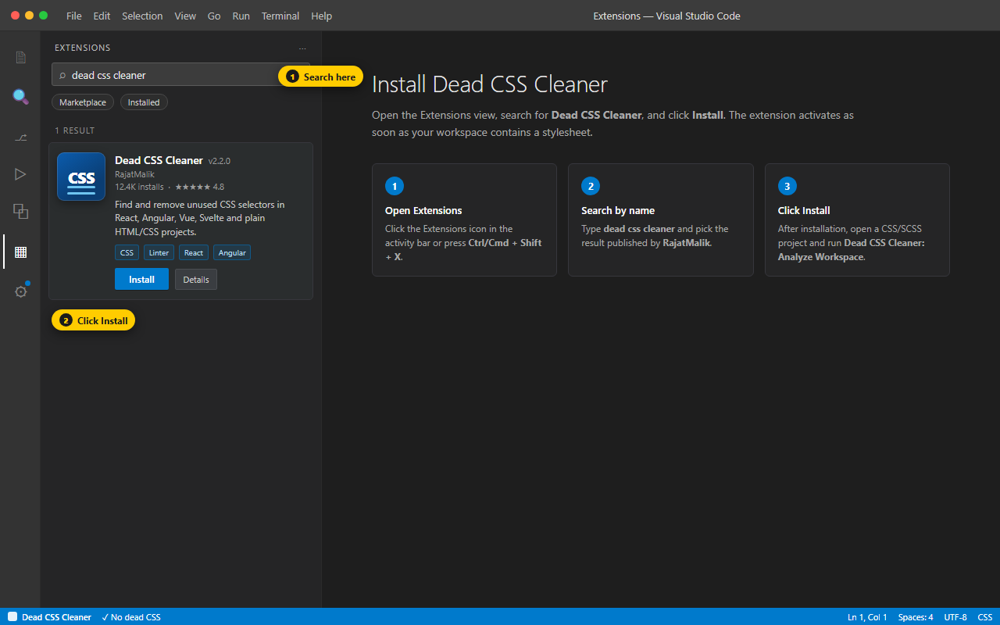
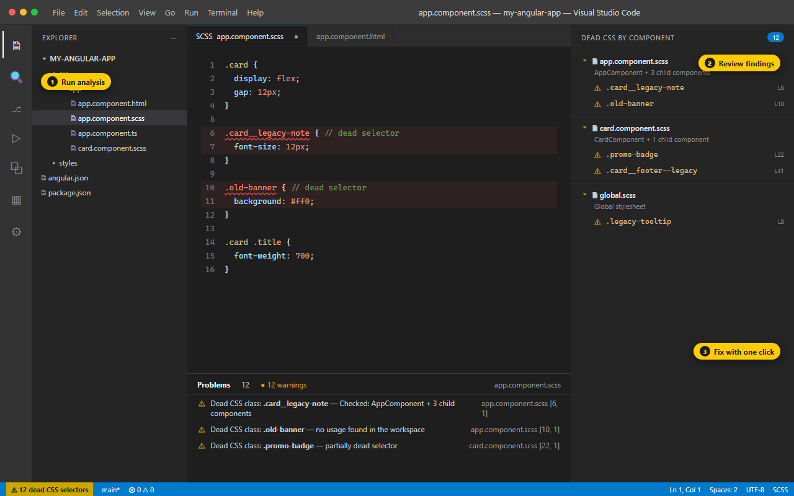
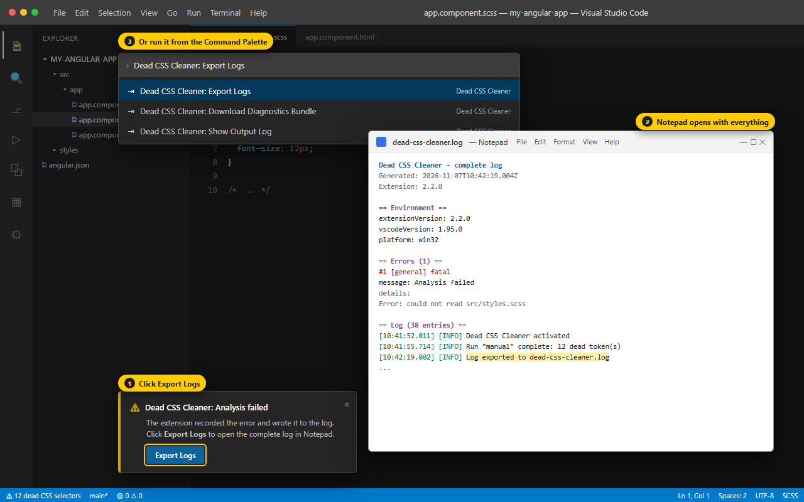
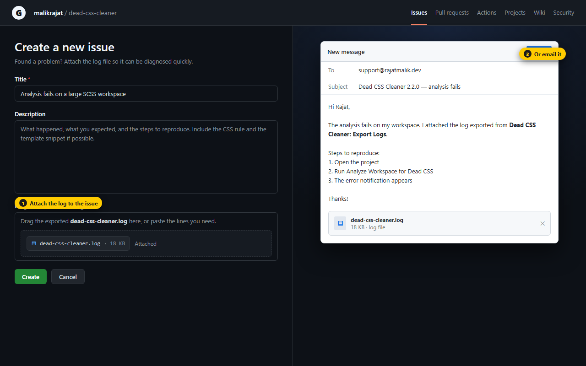

# Dead CSS Cleaner — visual guide

A four-step walkthrough for installing the extension, reading its results, exporting the log when
something goes wrong, and sending that log for support.

The screenshots below are mock-ups that show the exact controls and labels used by the extension.
The editable HTML sources live next to the PNG files in [`doc/screenshots/`](screenshots/).

---

## 1. Install from the Marketplace



1. Open the **Extensions** view (`Ctrl/Cmd + Shift + X`).
2. Search for **dead css cleaner**.
3. Select the result published by **RajatMalik** and click **Install**.

The extension activates automatically when the workspace contains a CSS, SCSS, Sass or Less file.

---

## 2. Run the analysis and review the findings



1. Run **Dead CSS Cleaner: Analyze Workspace for Dead CSS** from the Command Palette, the status
   bar, or `Ctrl/Cmd + Alt + D`.
2. Dead selectors appear:
   - underlined in the editor,
   - in the **Problems** panel with the checked component scope,
   - in the **Dead CSS by component** view in the activity bar.
3. Use the lightbulb quick fix to remove a token, remove the whole rule, or add an ignore comment.

---

## 3. Export the log



Logs are written continuously to a single file: `dead-css-cleaner.log`.

There are three ways to export it:

| Where | What to click |
| --- | --- |
| Error notification | **Export Logs** |
| Command Palette | **Dead CSS Cleaner: Export Logs** |
| **Dead CSS by component** view title | The export icon |

Clicking **Export Logs** rebuilds the complete file with the environment, every error and the full
session log, then opens it in **Notepad** on Windows (or the default text editor on macOS/Linux).

The file never contains source code. It only contains log lines, error messages and version
information, so it is safe to review before sending.

---

## 4. Send the log



Choose either route:

- **GitHub issue** — open the
  [bug report form](https://github.com/malikrajat/dead-css-cleaner/issues/new?template=bug_report.yml)
  and drag `dead-css-cleaner.log` into the **Diagnostics bundle or log** field. Add the CSS rule,
  the template snippet, your framework version and the analysis mode.
- **Email** — send the same file to **support@rajatmalik.dev** with a short description of what
  happened.

If you prefer a ZIP that also contains your `unusedCssDetector.*` settings and analysis statistics,
run **Dead CSS Cleaner: Download Diagnostics Bundle** from the Command Palette and attach the ZIP
instead.

---

## Where the log lives

The extension writes the log to VS Code's extension log folder:

```text
<VS Code log folder>/…/dead-css-cleaner.log
```

You normally do not need to find it manually — **Export Logs** opens it for you. If the log folder
is not writable, the extension falls back to `<system temp folder>/dead-css-cleaner/dead-css-cleaner.log`.

## Regenerating the screenshots

The `.html` files in `doc/screenshots/` are the editable sources. They are 1280×800 and can be
captured with any headless browser, for example:

```powershell
chrome --headless=new --window-size=1280,800 `
  --screenshot="doc/screenshots/01-install.png" `
  "file:///<repo>/doc/screenshots/install.html"
```

Replace `install.html` with `run-analysis.html`, `export-logs.html` or `send-logs.html`.
